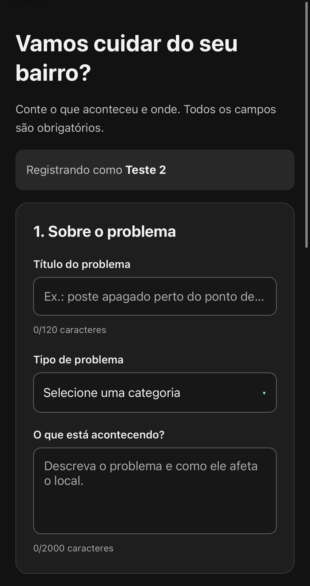
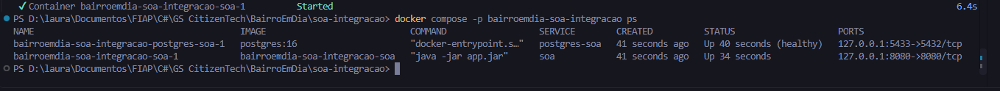
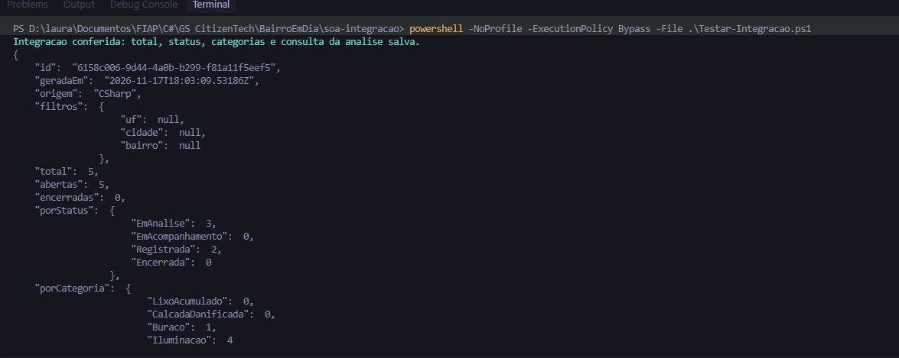
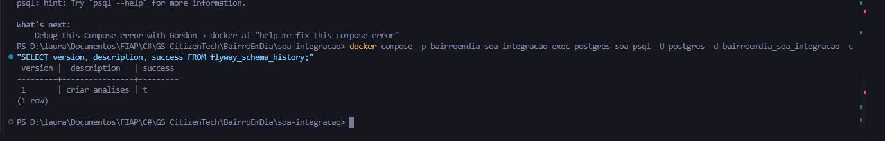

# Evidências do Bairro em Dia

## Aplicativo consumindo C#

[Vídeo de demonstração do aplicativo — 2min55s](https://youtube.com/shorts/rhYkBh2buLQ)

A gravação demonstra o registro de uma ocorrência, a consulta dos relatos e a atualização da situação pelo gestor. O aplicativo usa a API C# para essas operações.



## Serviços SOA e PostgreSQL

Os containers do SOA e PostgreSQL aparecem em execução; o PostgreSQL está com status `healthy`.



## Comunicação HTTP e persistência

Na execução da equipe em 17/11/2026, o script `Testar-Integracao.ps1` concluiu com a mensagem **Integracao conferida**. O script comparou a listagem da API C# com a análise gerada pelo SOA e consultou a análise salva pelo ID.

| Indicador na execução registrada | Resultado |
| --- | --- |
| Total de ocorrências | 5 |
| Abertas | 5 |
| Encerradas | 0 |
| Em análise | 3 |
| Registradas | 2 |
| Buracos | 1 |
| Iluminação | 4 |

Esses valores correspondem ao banco usado na demonstração e podem mudar com novos registros e atualizações.



## Migração no PostgreSQL

A consulta ao histórico Flyway retornou a versão `1`, descrição `criar analises`, com `success = t`.



## Reproduzir as verificações

Siga as instruções do [README principal](../README.md) para iniciar a API C#. Com ela ativa, execute a partir da raiz do backend:

```powershell
cd soa-integracao
docker compose -p bairroemdia-soa-integracao up --build -d
powershell -NoProfile -ExecutionPolicy Bypass -File .\Testar-Integracao.ps1
docker compose -p bairroemdia-soa-integracao exec postgres-soa psql -U postgres -d bairroemdia_soa_integracao -c "SELECT version, description, success FROM flyway_schema_history;"
```

Os testes automatizados podem ser executados com `dotnet test BairroEmDia.Tests/BairroEmDia.Tests.csproj` na raiz do backend e `mvn test` em `soa-integracao/soa`.
